# TripShot, redesigned

**A destination-first redesign of the University of Cincinnati's campus shuttle tracker.**

Built by Jonathan Cheruiyot, Sai Porumamilla and Evan Soreefan for the UI/UX course project "If it is broke, fix it."

- **Try it:** https://sai-porumamilla.github.io/TripShot_Redesign/ (live buses, on your phone or a laptop)
- **Source:** https://github.com/sai-porumamilla/TripShot_Redesign
- **Figma:** https://www.figma.com/design/F7E1kaUqpjY6kxHisKDWsN (page "Final design")
- **Demo video:** _link to add_

> **To fill in before publishing:** the demo video link, and check that the Figma file is shared as "anyone with the link can view".

<p>
  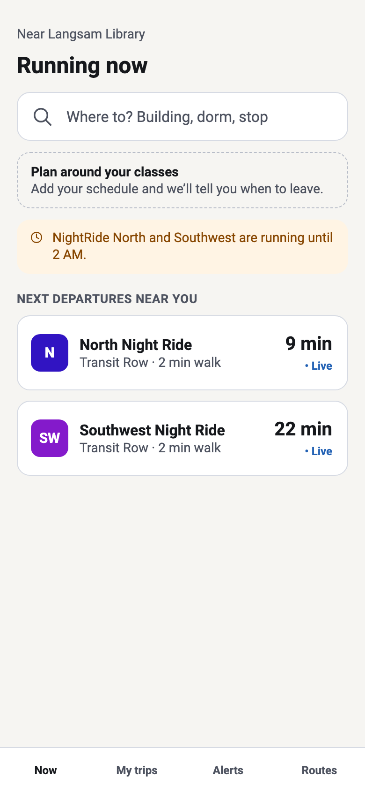
  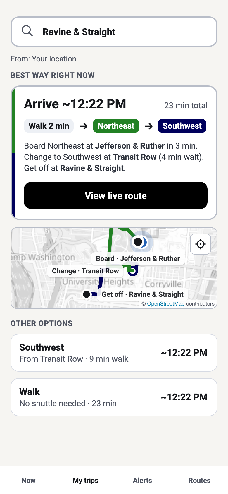
  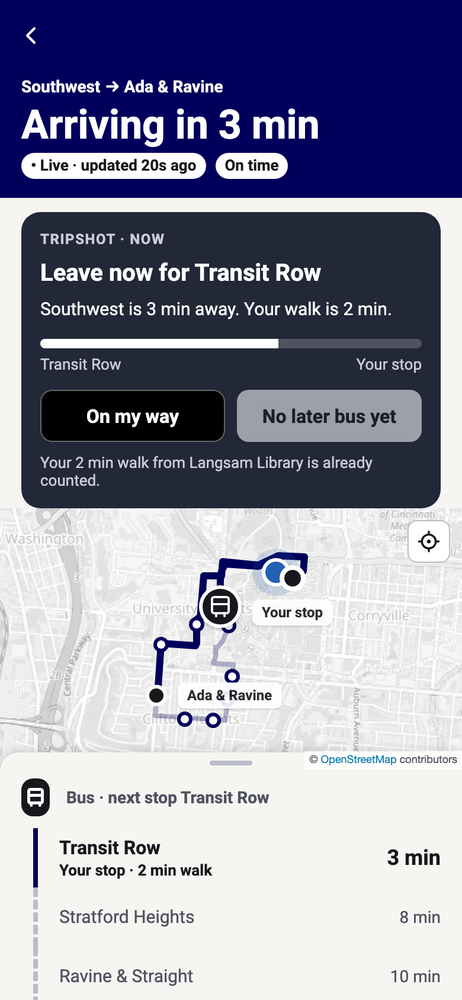
</p>

---

## Contents

1. [The project](#the-project)
2. [Why TripShot](#why-tripshot)
3. [Research and critique](#research-and-critique)
4. [From findings to design goals](#from-findings-to-design-goals)
5. [Design process](#design-process)
6. [The interface](#the-interface)
7. [How it's built](#how-its-built)
8. [Use of AI](#use-of-ai)
9. [Future work](#future-work)
10. [Run it locally](#run-it-locally)

---

## The project

TripShot is the shuttle tracker that UC licenses for its free campus shuttles: 8 daytime routes and 2 late-night NightRide routes. It shows a live map, routes and stops, arrival times, favorites and service alerts.

TripShot is organized around **routes**: to catch a shuttle, you first have to know which route you need. Students think in **destinations** ("I need to get to Digital Futures by 9:05"). This redesign turns the app around that question. You say where you're going, and it tells you which shuttle to take, when to leave, and what to do if something changes on the way.

It is a working prototype on **live UC shuttle data**, not a mock-up. Every screen below uses the real buses that are running when you open it.

## Why TripShot

- It's how UC students, staff and faculty get around campus for free without a car.
- For CS students with classes in Digital Futures, the shuttle has become a necessity.
- It matters for safety. NightRide runs late so students can get home after a long night of studying or a night out with friends.
- There's a lot of room to improve the interface.

## Research and critique

> **To fill in:** the brief asks for at least two research methods with specific findings (for example a survey, SUS scores, a think-aloud study, or timed tasks). Add the method names, who took part, and the results here. Everything below comes from our critique presentation.

### How TripShot works today: two core tasks

We walked through the two things students do most often in the current app.

**Task 1: "When's the next shuttle from Main Campus to University Edge?"**

1. Open the UC Mobile App or uc.tripshot.com and log in.
2. Choose **Routes** and work out which line serves your stop (for example, Southwest or Northwest).
3. Open the stop and check its arrival time and the live bus on the map.
4. Favorite the route or turn on alerts so you don't have to look it up again.

The trip planner does accept a destination, but it lists every route that could get you there, with a departure window like "Depart between 7:00 AM and 2:00 PM" rather than when to leave now.

**Task 2: "Get alerted when my shuttle is coming, and know if service has changed."**

1. Find your regular stop, for example the one by your apartment on the Northwest route.
2. Save the route as a favorite so it shows up first.
3. Check service alerts before heading out. Routes change for holidays (no shuttles over Thanksgiving, Nov 26–29), breaks, weather and summer cuts.

### What's not working

We grouped the problems we found into four areas.

| Area               | Problem                                                                                                                                                       |
| ------------------ | ------------------------------------------------------------------------------------------------------------------------------------------------------------- |
| **Usability**      | Seeing a route and its arrival time takes two separate steps. The trip planner lists every route to your destination instead of recommending one.             |
|                    | The system is built around routes, but students think about destinations. To choose between 8+ route names, you already need to know the system.              |
| **Learnability**   | Several apps and sites are listed, so a first-year student has no clear "official" one.                                                                       |
|                    | Day, NightRide, summer and break schedules all live in the same interface. Nothing says which routes are running right now; they just appear and disappear.   |
| **Errors**         | Route and time accuracy is poor, including wrong departure times. On a 30-minute NightRide loop, one bad arrival time can leave you waiting outside at night. |
|                    | When routes are suspended for weather or breaks, the alerts are easy to miss. A student might wait for a shuttle that isn't coming.                           |
| **Design choices** | The app looks generic, not designed for UC. It doesn't put a student's most common need first: "the next shuttle near me, right now."                         |
|                    | The safety features, NightRide and the late-night routes, look the same as everything else instead of standing out at night.                                  |

### What we found in TripShot's data

Building on TripShot's live data confirmed three of these problems in a concrete way:

- **Status labels are unreliable.** TripShot marks nearly every bus as "Delayed", so its own delay flag tells a rider nothing. Our app ignores it and works out delays from how much the arrival time actually slips (see [Delays](#delays-and-whats-still-faster)).
- **Closures are free text only.** On Oct 7, an MLK Drive closure moved boarding from Transit Row to Jefferson Avenue for up to an hour, sometime between 9:30 and 11:30 AM. TripShot only published it as a paragraph in the alerts list. Nothing on the map or the arrival times changed, so a rider who missed the alert went to a closed stop.
- **Arrival times only cover one lap.** TripShot lists each bus's arrival times for its current loop only, and runs each day route as scheduled shifts (7 AM–2 PM and 2–10 PM). When a bus is about to pass your stop before you can walk there, the data says nothing about when it comes back. An early version of our app fell into this: it sent a rider at University Edge on a 9-minute walk to chase the bus to a farther stop, when the right answer was to wait about 14 minutes at the stop 80 m away.

> **To fill in:** feedback on the design plans. The brief asks how we checked, before building, that the redesign would address these problems: who looked at the Figma frames, how, and what changed as a result.

## From findings to design goals

Each problem became a design goal, and each goal became a screen.

| Problem                                                              | Design goal                                                                             | Where it lives                                                    |
| -------------------------------------------------------------------- | --------------------------------------------------------------------------------------- | ----------------------------------------------------------------- |
| Built around routes; you have to know the system                     | **Start from the destination.** Type a building, dorm or stop; the app picks the route. | [Search](#search-by-destination)                                  |
| Trip planner lists every route                                       | **Recommend one best way**, and show the others only as alternatives.                   | [Search](#search-by-destination)                                  |
| Some trips need two shuttles, and riders have to work that out alone | **Plan the change for them**, and guide it on the bus.                                  | [Two shuttles](#two-shuttle-trips)                                |
| Not clear what's running right now                                   | **Open on what's running near you now.** Hide routes that aren't running.               | [Running now](#running-now)                                       |
| Route and arrival time are two steps apart                           | **One live route screen** with the arrival time, the map and your stop together.        | [Live route](#live-route)                                         |
| The bus is about to pass your stop before you can get there          | **Wait at your nearest stop for its next pass**, instead of chasing the bus.            | [Running now](#running-now), [Live route](#live-route)            |
| Bad arrival times leave you waiting                                  | **Tell you when to leave**, counting your walk, and re-plan when the bus slips.         | [Leave now](#leave-now), [Delays](#delays-and-whats-still-faster) |
| Closures are easy to miss                                            | **Apply closures to the trip itself**: the temporary stop, walk and times all change.   | [Service changes](#service-changes)                               |
| NightRide looks like everything else                                 | **A night mode** that switches on during NightRide hours.                               | [NightRide](#nightride)                                           |
| Generic, not designed for UC                                         | **Plan around your classes**, and use UC places and colors.                             | [My day](#my-day)                                                 |
| Riding home late at night                                            | **Let a friend follow your bus** until you get off.                                     | [Share my ride](#share-my-ride)                                   |

**What we kept from TripShot:** each route's own color (riders already know Northeast is green), the live bus on a map, and the stop list.

**What we deliberately left out:** login, settings and favorites management. They don't show a redesign goal, and the app works without an account. Saved trips and classes stay in your browser.

## Design process

We designed every screen in **Figma** before writing any code, for both a phone layout and a desktop layout. The "Final design" page holds 15 phone frames and 15 matching desktop frames, one pair per screen in this README. New features were drawn in Figma first, reviewed, and only then built.

**Two layouts, one app.** Below 900 px wide it is the phone design, with a bottom tab bar. At 900 px and up it is the desktop design, with a top bar and a side menu. The four tabs are the same in both: **Now**, **My trips**, **Alerts** and **Routes**.

**Color rules.** Color only carries meaning:

| Color                  | Used only for                                   |
| ---------------------- | ----------------------------------------------- |
| UC black               | Buttons and actions                             |
| Each route's own color | Route context: badges, route headers, map lines |
| UC red                 | Alerts, delays and closures                     |
| TripShot magenta       | The logo                                        |
| Amber (at night)       | Buttons and "you" on the map, in NightRide mode |

Text on a route color is black or white, whichever reads better on that color.

**Maps** use OpenStreetMap, muted to gray, so the route lines, the bus and your stop stand out.

**Motion and touch.** Little motion, on purpose, following Emil Kowalski's design-engineering guidelines:

- Buttons and cards shrink slightly when pressed. The tab bar doesn't animate, because it's used too often.
- Things that appear while you're watching (leave now, a delay, "your stop is next") settle in instead of popping.
- Bottom sheets slide up from the edge.
- Countdown numbers don't animate, because you're reading them.
- With the phone's "reduce motion" setting on, fades stay and slides go, and the map stops animating.
- Digits are all the same width, so live countdowns don't jitter.

## The interface

Screenshots are of the live app. Each section shows the phone layout; the desktop version is linked below it. All screens also come in NightRide mode, in [`docs/screenshots/night/`](docs/screenshots/night/).

### Running now

**The home screen answers "what can I catch near me, right now?"**

- It shows only routes that are actually running, nearest stop first, with the walk to that stop and a live countdown.
- A notice says which service is running ("NightRide North and Southwest are running until 2 AM").
- The search box ("Where to? Building, dorm, stop") is the first thing on the page.
- Tap a departure to open its live route.
- **It doesn't send you chasing a bus.** If a bus will pass your nearest stop before you can walk there, the app counts its next pass. That's its next lap, or the next scheduled ride after a shift change. A farther stop only wins if it gets you on a bus 5 or more minutes sooner. Estimated times show in gray as "Next lap" or "Scheduled" instead of "• Live" (see [Live route](#live-route) for an example).


[Desktop](docs/screenshots/day/desktop-01-running-now.png)

### Search by destination

**Type where you're going, and get one recommended way to get there.**

- Search covers 107 campus buildings, dorms, apartments, libraries and garages, plus every shuttle stop.
- The **Best way right now** card gives the arrival time, the total trip time, each step (walk, shuttle, walk) and a map preview.
- **Other options** lists the alternatives, including walking.
- **The recommendation rule:** saving less than 5 minutes isn't worth extra walking or an extra shuttle. Walking is only recommended if it beats the best shuttle by 5 minutes or more. Among shuttle trips arriving within 5 minutes of the fastest, the one with the least walking wins.
- On desktop, a **Your journey** timeline lists every step with its time.

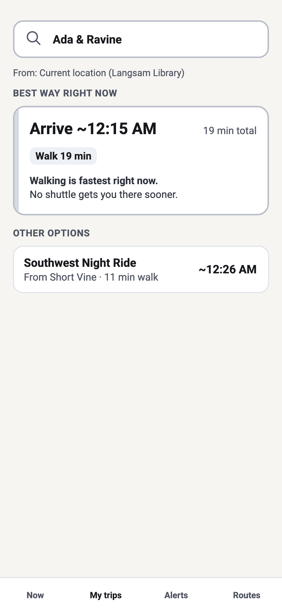

[Desktop](docs/screenshots/day/desktop-02-search.png)

### Two-shuttle trips

**Some trips need two shuttles. The app plans the change and guides you through it.**

From University Edge to Ravine & Straight, no single route goes all the way. The best way is Northeast to Transit Row, then Southwest.

- **Search** shows both route badges ("Walk 2 min → Northeast → Southwest"), where to change and how long you'll wait there. The map draws each leg in its route's color.
- The second bus must leave at least a minute after you arrive (plus any short walk between stops), and no more than 20 minutes later.
- **On the bus,** a **Change here** card shows when the next Southwest leaves the change stop, with a button to its live route. When you arrive, the headline becomes "Change here: Southwest".

| Search                                                                                                  | At the change stop                                                                                 |
| ------------------------------------------------------------------------------------------------------- | -------------------------------------------------------------------------------------------------- |
|  | 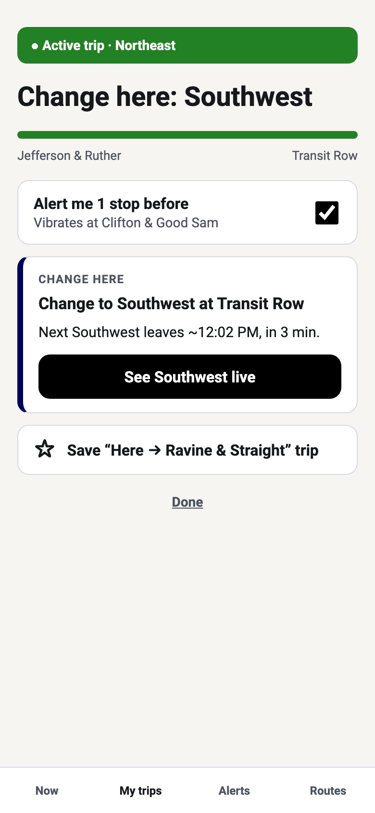 |

Desktop: [search](docs/screenshots/day/desktop-14-two-shuttles.png) · [change here](docs/screenshots/day/desktop-15-change-here.png)

### Live route

**One screen with everything about the bus you're catching.**

- The header gives the arrival time in large type, how fresh the data is ("Live · updated 7s ago") and whether it's on time.
- The map shows the route, the live bus, your stop, your destination and the walk from where you are.
- The stop list marks **your stop** with your walk time.
- **Tell me when to leave** sets a reminder (see [Leave now](#leave-now)).
- **I'm on the bus** opens the [On board](#on-board) screen.

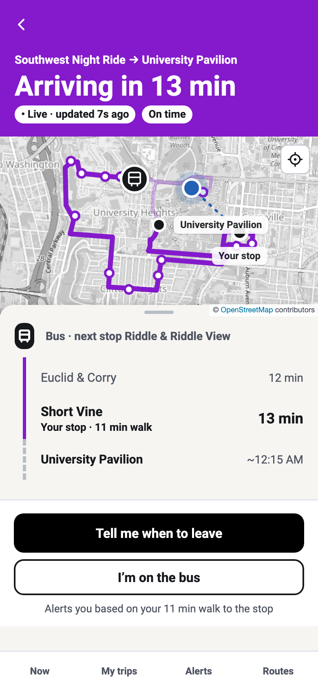

[Desktop](docs/screenshots/day/desktop-03-live-route.png)

**When the bus is too close to catch.**

- The page checks each bus once, when it first sees it, using the same rule as Running now.
- **Too close to catch:** the page shows **"Next one in ~14 min"** with a "Next lap" or "Scheduled" pill, and explains why. After the last bus of the day it says **"No more Northeast today"**.
- **Catchable when first seen:** the bus stays followed as it gets close, so you don't lose it while walking to the stop.
- **When a bus passes and comes back round,** that's a new pass, not a 13-minute delay.

These two screenshots use a simulated bus. The rider is at University Edge, 2 minutes from Jefferson & Ruther, and the only Northeast bus is about to pass it:

| Running now                                                                                                            | Live route                                                                                                     |
| ---------------------------------------------------------------------------------------------------------------------- | -------------------------------------------------------------------------------------------------------------- |
| 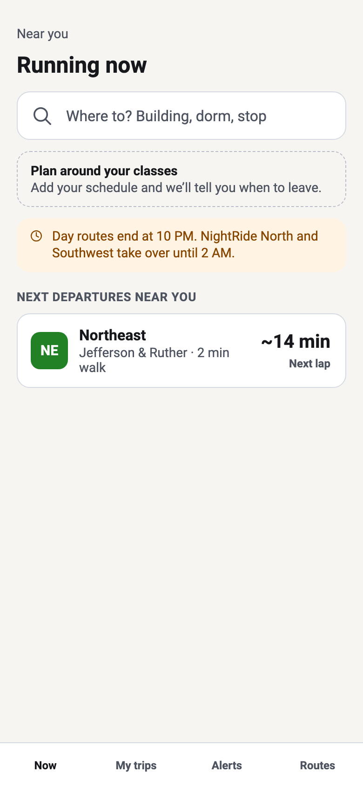 | 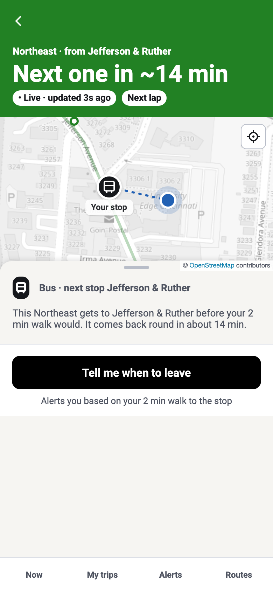 |

### Leave now

**The reminder counts your walk, so you leave at the right moment.**

- The alert fires when the bus is your walk time plus one minute away from your stop.
- The card says why: "Southwest is 3 min away. Your walk is 2 min."
- **On my way** dismisses it. **Snooze 1 bus** skips this bus and sets the reminder for the next one.
- If the bus slips after the reminder fires, it re-arms for the new time.


[Desktop](docs/screenshots/day/desktop-06-leave-now.png)

### Delays and what's still faster

**The app spots a delay itself, and checks whether another option is now faster.**

- Because TripShot's own "Delayed" label is on nearly every bus, the app watches the arrival time instead. A delay is when it slips 3 or more minutes past the first time we saw.
- The page then shows **"Delayed 6 min"**, the change ("ETA changed: 13 min → 19 min") with a reason, and moves your leave-now alert to match ("Alert moved to 12:03 AM").
- **Still faster?** compares waiting for this bus with another route or walking. In the screenshot, walking now gets you there 27 minutes sooner.
- The screenshot replays a 5-minute traffic delay on live buses, which you can start from the **Alerts** tab.

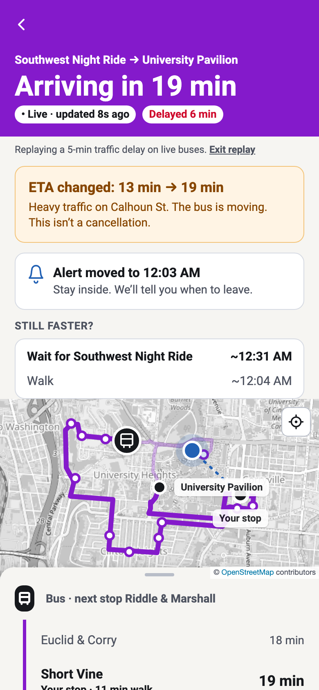

[Desktop](docs/screenshots/day/desktop-05-delay.png)

### On board

**After you board, the app follows your bus and tells you when to get off.**

- It follows the one bus you're on, by name.
- The headline counts down ("3 stops to Ada & Ravine") and a progress bar fills as you go.
- **Alert me 1 stop before** vibrates and sends a notification at the stop before yours. It only fires once the bus has left your boarding stop.
- **Save trip** makes it one tap next time, from **My trips**.
- On loop routes, the bus comes back round. The app remembers that you rode past your boarding stop, even after a reload, so it still shows you've arrived.

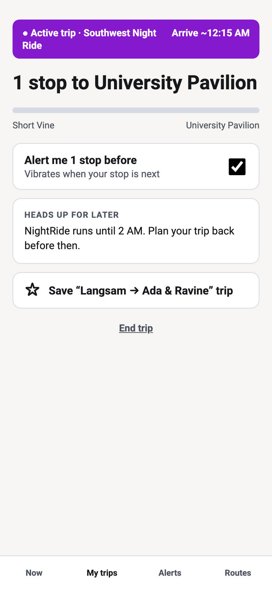

[Desktop](docs/screenshots/day/desktop-07-on-board.png)

### Share my ride

**Let a friend follow your bus until you get off, which matters most on the way home at night.**

- From the On board screen, **Share my ride** makes a link, shared through your phone's share sheet or copied. Adding your name is optional.
- The friend's page follows **the bus, never your phone's location**. It shows "Boarding at Transit Row", the stops left and when you'll get off, and it says "Got off" once the bus passes your stop.
- The link stops working an hour after the expected arrival.

| Sharing                                                                                     | What your friend sees                                                                         |
| ------------------------------------------------------------------------------------------- | --------------------------------------------------------------------------------------------- |
| 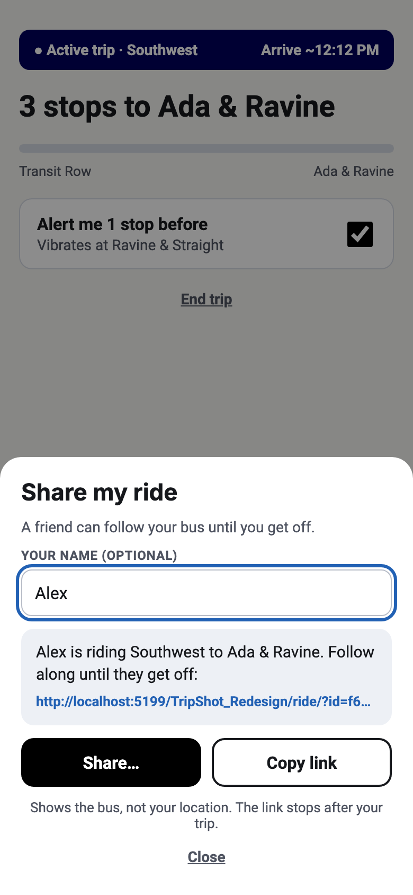 | 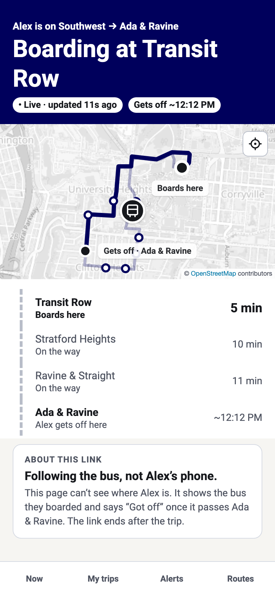 |

Desktop: [sharing](docs/screenshots/day/desktop-12-share-my-ride.png) · [friend's view](docs/screenshots/day/desktop-13-friend-view.png)

### Service changes

**A closure changes the trip itself, not just a line in an alert list.**

- For the Oct 7 MLK Drive closure, every screen moves to the temporary stop. Departures, walk times, the live route and the map all follow it.
- The map shows the closed road, the closed stop and an arrow to where to board today.
- TripShot doesn't publish closures as data we can read, so this one is a replay of the real alert on today's live buses, labeled as a replay. Try it: [`?scenario=mlk-closure`](https://sai-porumamilla.github.io/TripShot_Redesign/?scenario=mlk-closure).

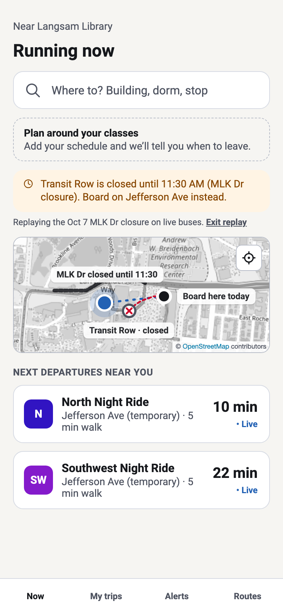

[Desktop](docs/screenshots/day/desktop-08-service-change.png)

### NightRide

**At night the app looks different, so the late-night service stands out.**

- From 10 PM to 2 AM campus time, the whole app switches to a dark theme with amber buttons.
- Day routes drop off the list as they end, and NightRide North and Southwest come first.
- On the bus during the day, a heads-up tells you which NightRide gets you back after 10 PM.
- Preview it any time with [`?theme=night`](https://sai-porumamilla.github.io/TripShot_Redesign/?theme=night).

| Running now at night                                                                               | Live route at night                                                                              |
| -------------------------------------------------------------------------------------------------- | ------------------------------------------------------------------------------------------------ |
| 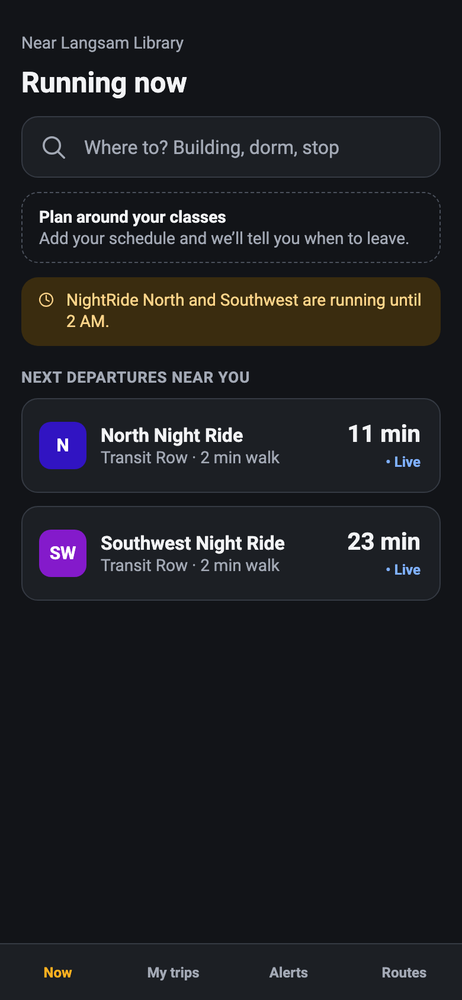 | 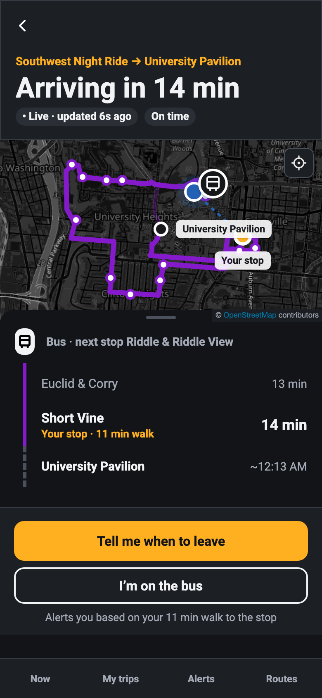 |

### My day

**Plan around your classes instead of looking up routes.**

- Add your classes by hand, import a calendar file (.ics), or try a sample schedule. They're kept in your browser only.
- For each class, the app finds the **latest** shuttle that still gets you there 5 minutes early, and tells you when to leave.
- Classes more than 45 minutes away show "We'll plan it at …" plus today's typical trip time, since live data that far ahead isn't reliable.
- The next class appears as a card on **Running now**, with **Remind me**.

| Next class on Running now                                                                  | My day                                                                                 | Add a class                                                                           |
| ------------------------------------------------------------------------------------------ | -------------------------------------------------------------------------------------- | ------------------------------------------------------------------------------------- |
| 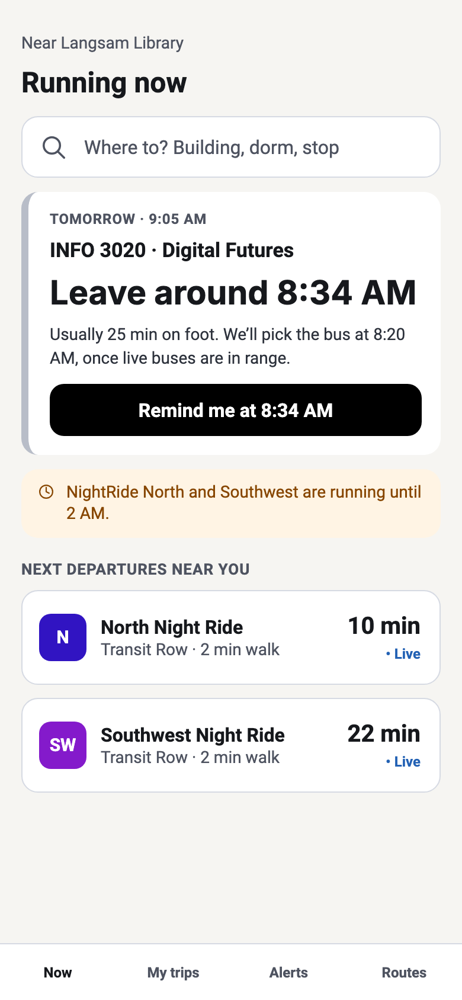 | 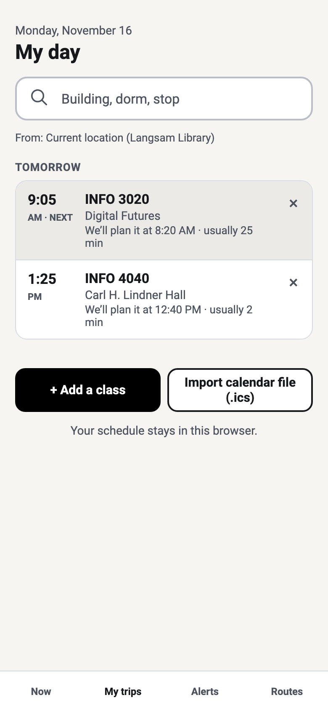 | 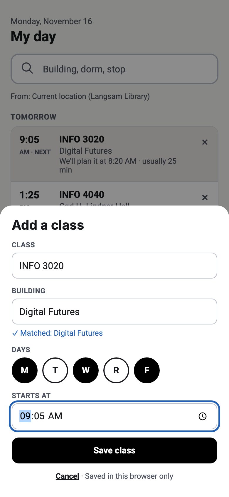 |

Desktop: [next class](docs/screenshots/day/desktop-09-next-class.png) · [my day](docs/screenshots/day/desktop-10-my-day.png) · [add a class](docs/screenshots/day/desktop-11-add-class.png)

### Routes and Alerts

- **Routes** lists every route running today in its color, each linking to its live route. It's for riders who do know their route.
- **Alerts** explains service changes and how your leave-now reminders work. TripShot's live alerts aren't connected yet, so it offers the MLK closure and traffic delay replays.

| Routes                                                                     | Alerts                                                                     |
| -------------------------------------------------------------------------- | -------------------------------------------------------------------------- |
| 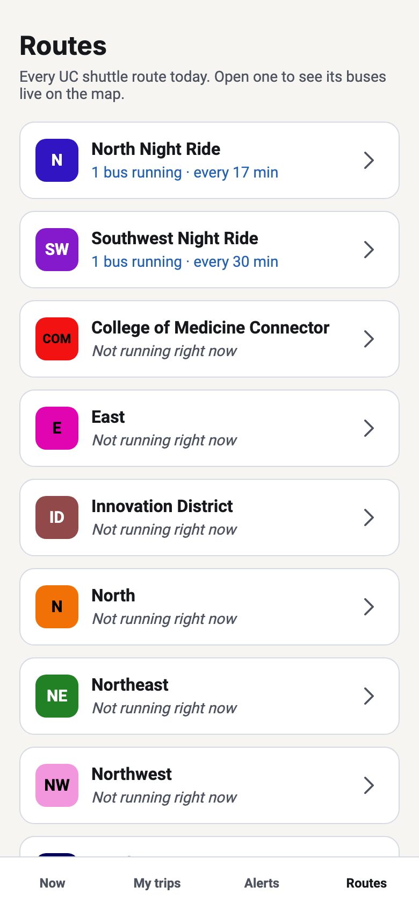 | 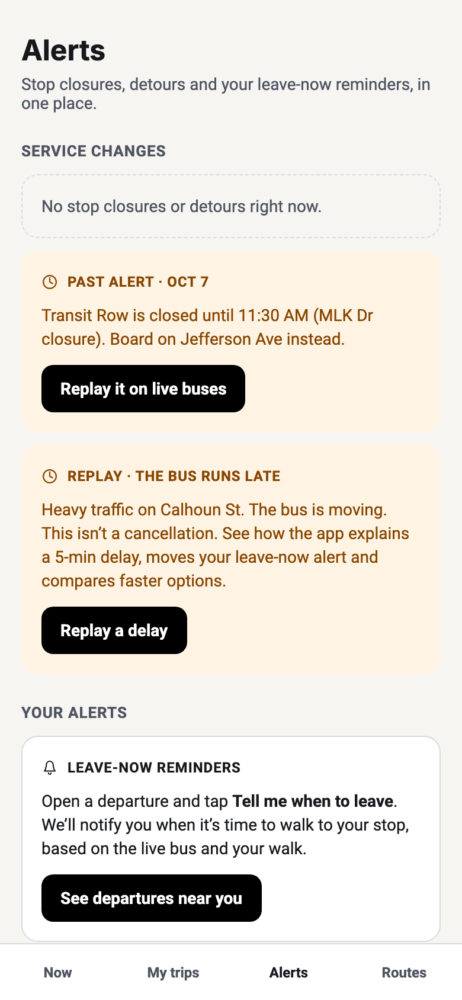 |

## How it's built

### Stack

| Part      | What we used                                                                                                          |
| --------- | --------------------------------------------------------------------------------------------------------------------- |
| Framework | [SvelteKit](https://svelte.dev/docs/kit) with Svelte 5 (runes), in JavaScript with JSDoc types                        |
| Maps      | [Leaflet](https://leafletjs.com/) 1.9 with OpenStreetMap tiles                                                        |
| Hosting   | GitHub Pages, as a fully static site (`@sveltejs/adapter-static`), deployed by GitHub Actions on every push to `main` |
| Live data | A small Cloudflare Worker (`proxy/`) in front of UC's TripShot API                                                    |
| Quality   | Vitest unit tests, `svelte-check` type checking, ESLint and Prettier                                                  |

### Live data

UC's TripShot API needs a login and doesn't allow calls from other websites, so the browser can't use it directly. The Worker in `proxy/` logs in on the server and serves a small, read-only set of endpoints: every route running today with its live buses, the stops, and each route's path.

It only passes on what the app needs. The upstream data includes driver, shift and device IDs, and the Worker never returns them. It also caches responses (live buses for 10 seconds) so the app doesn't overload TripShot.

Besides live positions and arrival times, it passes on two pieces of TripShot's schedule, as times and stop IDs only:

- when each bus's scheduled ride ends
- the rides scheduled later today

The app uses them to work out when a bus comes back after one you can't catch.

### Code structure

```
src/
  routes/              one folder per page
    +page.svelte       Running now
    search/            Search by destination, and My day before you type
    route/             Live route (leave-now, delays, the second shuttle's notice)
    trip/              On board (stop alert, change here, Share my ride)
    ride/              The friend's view of a shared ride
    routes/  alerts/   Routes and Alerts tabs
    +layout.svelte     The shell: bottom tabs on phones, top bar and sidebar on desktop
  lib/
    trips.js           Trip planning: walk vs. one or two shuttles, the 5-minute rule
    departures.js      Distances, walk times, which buses you can still catch, when the next one comes
    route.js           Which bus to follow, trip progress, a shared ride's status
    schedule.js        Class times in campus time, arrive-by planning, .ics import
    serviceChanges.js  Applies a closure or delay to live data
    RouteMap.svelte    The Leaflet map used on every screen
    places.json        107 campus places from OpenStreetMap
proxy/                 The Cloudflare Worker
docs/screenshots/      Every screen, day and night, phone and desktop
```

The trip logic (`trips.js`, `departures.js`, `route.js`, `schedule.js`, `serviceChanges.js`) is plain functions with no page code, so it's covered by unit tests. The pages only display what those functions return.

### Your location

The app uses your real location only within 3 km of campus. Anywhere else, it pretends you're at Langsam Library, so the demo works for graders off campus.

## Use of AI

> **To review:** check this section matches how the team actually worked, and edit it to fit.

We used **Claude Code** (Anthropic's coding assistant) throughout the build:

- **Code:** it wrote most of the SvelteKit app and the Cloudflare Worker from our Figma designs and descriptions, one feature per branch and pull request.
- **Figma:** it drafted the newer frames (My day, Share my ride, two-shuttle trips) in our Figma file through Figma's plugin API. We reviewed them before any code was written.
- **Testing:** besides unit tests, it drove the real app in a headless browser at phone and desktop sizes, and took the screenshots in this README.
- **Design references:** for motion and mobile details, we had it follow [Emil Kowalski's design-engineering skills](https://github.com/emilkowalski/skills) and the accessible-animation skill from [iart-ai's web animation skills](https://github.com/iart-ai/web-animation-skills). It also used them to rule out motion that wouldn't help.

**Where it helped:** it moved fast on well-defined screens and kept the phone and desktop layouts consistent with each other and with the Figma frames.

**Where it fell short:** unit tests passing didn't mean a feature worked. Several bugs only showed up when it ran the real app against real or simulated buses. For example, a loop route's bus coming back round made a finished trip look unfinished, and Uptown Express crashed the live route page because it passes Transit Row more than once a lap. Late at night no buses were running, so testing needed a simulated live feed. The design judgment stayed with us: which problems to solve, the 5-minute recommendation rule, and the color rules.

## Future work

- **Real service alerts.** TripShot's alerts aren't available to our proxy yet, so closures are replayed rather than read live. Next step: parse TripShot's alert feed into the same closure format the app already uses.
- **Reminders with the page closed.** Leave-now and stop alerts need the page to stay open. A service worker with push notifications would remove that limit.
- **Real-world checks.** Some behavior was tested on a simulated live feed, because the buses it needs weren't running at the time. We still need to see these on real buses:
  - two-shuttle trips, including whether a Northeast bus lists Transit Row at the end of its loop, which the change relies on
  - the 2 PM shift change
  - the last bus at 10 PM
- **Follow your location as you walk.** The live route page reads your location once, so your walk time doesn't shrink as you get closer. Watching the location would make "too close to catch" and the leave-now alert more accurate.
- **NightRide contrast.** Southwest's navy route color is faint on the dark night background. A lighter outline at night would fix it.
- **Usability testing of the prototype** with students, repeating the two tasks above to compare against TripShot.
- **Trips with more than one change**, if real trips ever need them.

## Run it locally

You need Node 24.

```sh
npm install
npm run dev        # http://localhost:5173
npm test           # unit tests
npm run check      # type check
npm run build      # static site in build/
```

The app reads live data from the deployed proxy, so it works without running the Worker. To run the Worker locally, see `proxy/` (it needs TripShot login details in `proxy/.dev.vars`, which is not committed).

Map data © [OpenStreetMap](https://www.openstreetmap.org/copyright) contributors. Campus places are from OpenStreetMap (ODbL).
